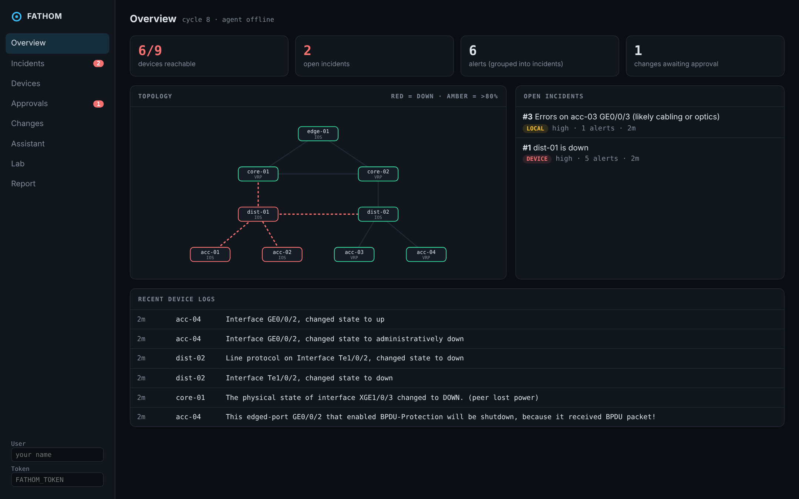
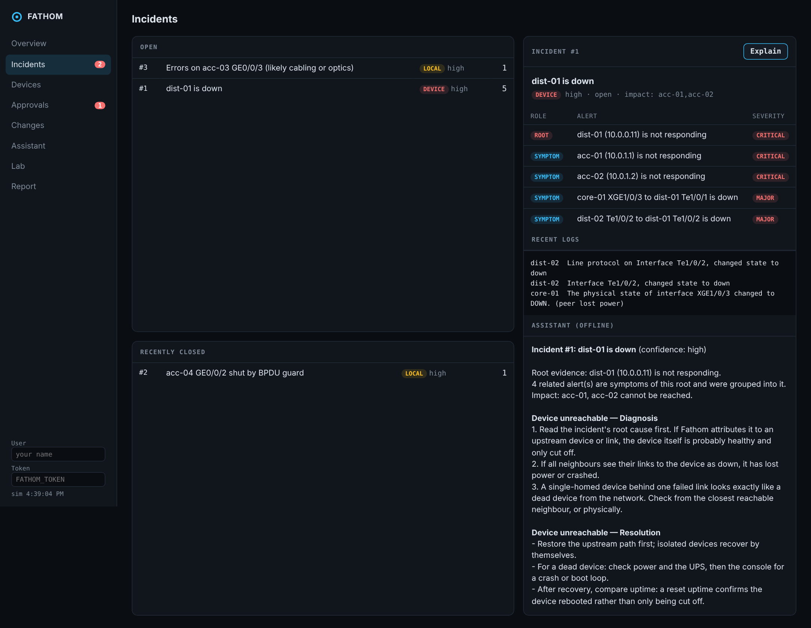
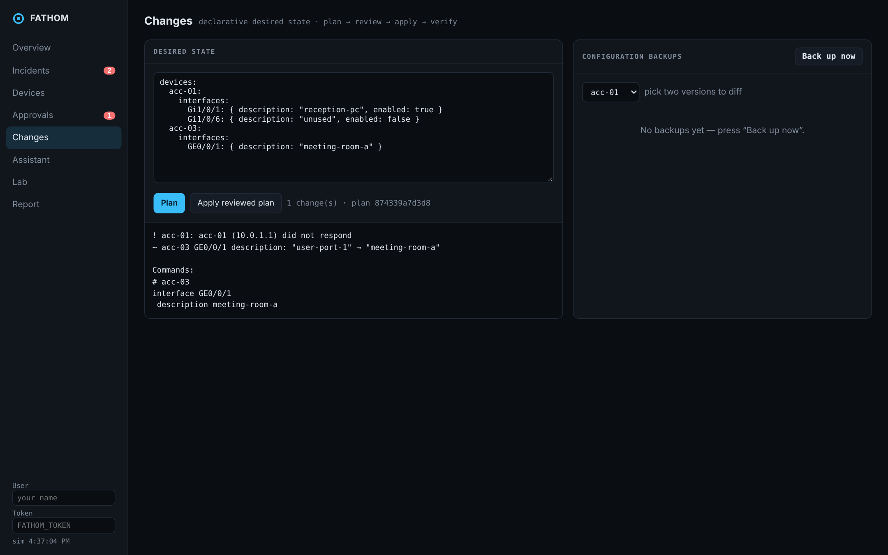

# Fathom

[](https://github.com/Jamie-233/fathom/actions/workflows/ci.yml)
[](LICENSE)
[](pyproject.toml)
[](Dockerfile)
[](https://github.com/Jamie-233/fathom/stargazers)

**An AIOps platform for networks.** Fathom polls switches, turns vendor CLI output into data, groups alerts into incidents by topology-aware root cause, fixes what is safe to fix automatically, puts everything else behind human approval, delivers configuration as reviewed plans, and lets an AI agent investigate incidents with read-only tools.

It ships with a simulated multi-vendor campus network (Cisco IOS and Huawei VRP) and fault injection, so the whole loop runs on a laptop with no hardware.



## The loop

```
  devices ──CLI/syslog──▶ collect ──▶ rules ──▶ root cause ──▶ incident ──▶ notify (webhook / Alertmanager)
     ▲                     │ rates     │ pending   │ topology     │
     │                     ▼           ▼ periods   ▼              ▼
     └──── verify ◀── apply ◀── approve ◀── runbook job      agent + runbooks (RAG)
                         ▲
              desired state (plan → review → apply) ◀── NetBox webhook
```

## Quick start

```bash
pip install -e .
fathom serve            # portal + API on http://127.0.0.1:8000, API docs at /docs
```

Open the **Lab** tab, power off `dist-01`, and watch: the neighbours' links drop, two access switches become unreachable, and Fathom opens **one** incident — *dist-01 is down* — with the other four alerts grouped under it as symptoms.

Command line, no server needed:

```bash
fathom verify                              # live checks; exit 1 on failure
fathom plan examples/desired.yml           # exit 2 when changes are pending
fathom ask "what is broken?" --fault power_off:dist-01
fathom report --html > report.html
```

With Docker: `docker build -t fathom . && docker run -p 8000:8000 -v fathom:/data fathom`

## Package map

Each package owns one layer of the loop, so a change in one does not leak into
another. If you only read one file per layer, these are the ones to start with.

| Package | What it does |
|---|---|
| `data/parsers.py` | Regex parsing of `show interfaces` / `display interface brief`, canonical interface names, structured records |
| `data/store.py`, `config/`, `devices/transport.py` | SQLite inventory and telemetry; Jinja2 templates per vendor; config backup with change detection, diff and restore; Netmiko SSH transport |
| `api/` | FastAPI + Pydantic REST API with token auth; signed, idempotent, loop-safe NetBox webhook that drives device changes |
| `observe/` | Counter-wrap/reset-safe rates, syslog events, alert rules with pending periods, Prometheus `/metrics`, Alertmanager-format notifications, pre/post-change snapshot verification |
| `ops/remediation.py` | Event-driven runbooks — the off-box equivalent of EEM applets — with attempt budgets |
| `ops/static/`, `ops/report.py` | Web portal (topology, incidents, approvals, changes, lab); inspection report in Markdown/HTML |
| `delivery/iac.py`, `.github/workflows/` | Declarative desired state, minimal plan, stale-plan protection, apply-then-verify; CI with a network verification gate |
| `ai/` | Topology-aware RCA; BM25 runbook knowledge base (CJK-aware); function-calling agent with read-only tools; MCP server for Cursor/Claude |

Out of scope by design: anything that needs real infrastructure or heavy external systems — SNMP/gNMI against hardware, Elastic, NetFlow, on-box GuestShell/ZTP, NSO, and model fine-tuning. The transport boundary is where SNMP or gNMI collectors would plug in.

## Root cause analysis



Every firing alert is attributed to a single root by walking the shortest path from the poller to each unreachable device and stopping at the first broken element:

- **Device fault** — every reachable neighbour sees its link to the device as down. High confidence.
- **Link or single-homed device** — one cut link isolates a device with no other path. From the outside a dead switch and a cut cable look identical, so Fathom says exactly that, with medium confidence, instead of guessing.
- **Redundancy lost** — a link failed but nothing became unreachable. Its own incident; both ends' alerts are merged into it.
- **Local** — errors, CPU and congestion have no topological relationship and are their own root.

## Safe automation

| Risk | Example | Who decides |
|---|---|---|
| read-only | collect CPU diagnostics on a CPU alert | automatic |
| low | re-enable a port shut by BPDU guard | automatic, **at most twice per hour per port**, then a human |
| medium | shut a user port with sustained CRC errors | approval required |
| refused | shut an infrastructure link | never queued |

- **Four-eyes rule.** Whoever requests a change cannot approve it — person, agent or MCP client.
- **Verification.** Every job and every apply reads the device back. Every apply is compared with a pre-change snapshot; only *regressions* fail it, so an unrelated fault elsewhere never blocks work.
- **Audit.** Every action records its actor: a user, `fathom-auto`, `netbox`, or `agent`.

## Configuration as code



```yaml
devices:
  acc-01:
    interfaces:
      Gi1/0/6: { description: "unused", enabled: false }
```

`plan` reads live state from the devices, so manual changes show up as drift, and only declared fields are managed. `apply` takes a plan **id**, never a new file, so what runs is exactly what was reviewed. If a device changed in between, apply refuses and asks for a new plan.

## AI agent and MCP

The agent sees what an on-call engineer sees: incidents with root/symptom roles, device and port state, recent logs, runbooks, and allow-listed show commands. It **cannot change devices**. Its only write is `propose_port_change`, which queues a job for a human.

Without an LLM configured, questions are answered deterministically from RCA and the runbooks. To use a model, point it at any OpenAI-compatible endpoint (OpenAI, DeepSeek, or Ollama for fully local operation):

```bash
export FATHOM_LLM_BASE_URL=http://localhost:11434/v1 FATHOM_LLM_MODEL=qwen2.5:7b
```

MCP for Cursor or Claude Desktop — the server is a client of the REST API, so it has the same permissions and audit trail as the portal:

```json
{ "mcpServers": { "fathom": { "command": "fathom", "args": ["mcp"],
  "env": { "FATHOM_URL": "http://127.0.0.1:8000", "FATHOM_USER": "cursor" } } } }
```

## API

Interactive docs at `/docs`. Highlights:

| Endpoint | |
|---|---|
| `GET /api/incidents`, `/api/incidents/{id}` | incidents with root vs. symptom alerts |
| `GET /api/topology` | nodes and links with state and utilisation |
| `POST /api/iac/plan`, `POST /api/iac/apply` | plan returns an id; apply takes only that id |
| `POST /api/jobs`, `/api/jobs/{id}/approve` | propose and approve changes (four-eyes) |
| `POST /api/webhooks/netbox` | HMAC-SHA512 signed NetBox events |
| `GET /metrics` | Prometheus exposition |
| `GET /api/report?format=html` | inspection report |
| `POST /api/agent/ask` | ask the assistant |

Writes require `Authorization: Bearer $FATHOM_TOKEN` when the token is set, and record `X-Fathom-User`.

## Project layout

```
src/fathom/
  devices/    simulated lab, vendor CLI rendering, transports (lab, SSH)
  data/       parsers, SQLite store with audit trail
  config/     vendor templates, backup / diff / restore
  api/        FastAPI app, NetBox webhook
  observe/    collector, alert rules, metrics, verification
  ops/        remediation runbooks, report, web portal
  delivery/   desired state plan / apply
  ai/         root cause analysis, knowledge base, agent, MCP server
  platform.py the evaluation cycle that wires it together
```

## Development

```bash
pip install -e '.[dev]'
pytest
```

The test suite drives faults through the simulated lab and asserts on outcomes end to end: parsing both vendors, counter wrap and reset, pending periods, RCA for device/link/redundancy failures, approval and escalation, plan/apply/drift, webhook signatures and loops, MCP framing, and the agent loop against a fake OpenAI-compatible server.

## License

MIT
